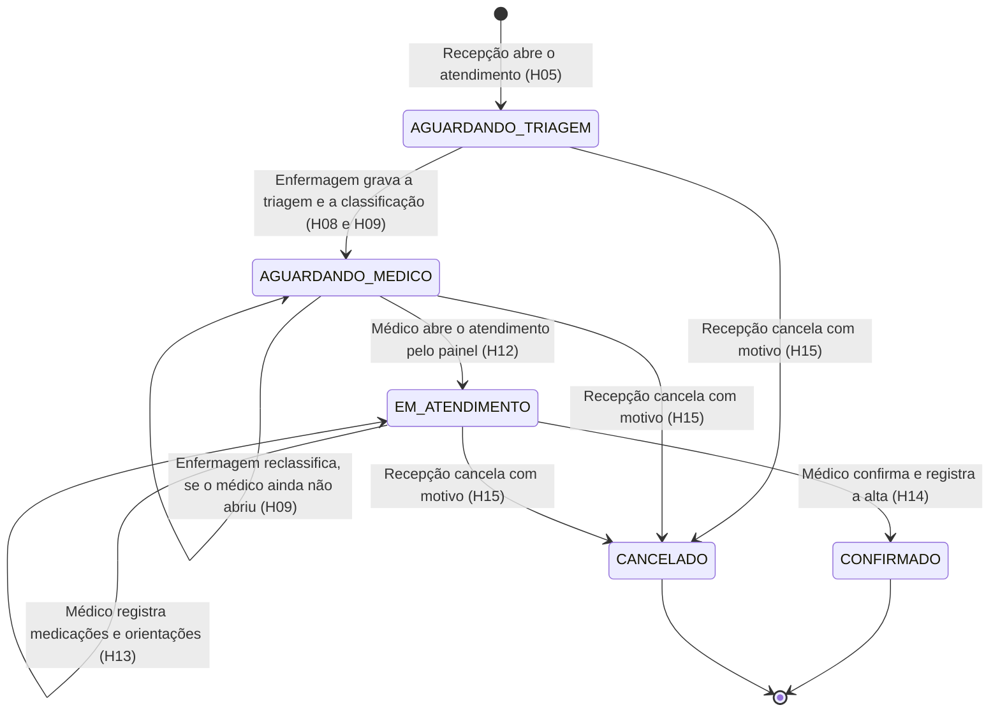

# Estados do atendimento

Situações que o atendimento passa no sistema, gravadas na coluna `status` da tabela `atendimento`.

## Regras

1. O número do atendimento (AT0001, AT0002...) é gerado pelo sistema ao abrir, já em `AGUARDANDO_TRIAGEM`.
2. A triagem só é gravada em `AGUARDANDO_TRIAGEM` e manda o atendimento para `AGUARDANDO_MEDICO`.
3. O painel do médico mostra só `AGUARDANDO_MEDICO`, ordenado pela cor (Vermelho, Laranja, Amarelo, Verde, Azul) e, na mesma cor, pela ordem da triagem.
4. A reclassificação só é aceita em `AGUARDANDO_MEDICO`. Quando o médico abre o atendimento ele vai para `EM_ATENDIMENTO`, e a enfermagem não pode mais reclassificar.
5. Medicações e orientações só são gravadas em `EM_ATENDIMENTO`.
6. A alta só é registrada em `EM_ATENDIMENTO`, gravando a data e hora em `data_hora_confirmacao`.
7. O cancelamento exige motivo e é aceito em qualquer situação antes de `CONFIRMADO`.
8. `CONFIRMADO` (Confirmado / Alta) e `CANCELADO` são finais. O atendimento continua aparecendo na consulta, mas recusa alteração e cancelamento.

## Onde cada mudança acontece no back-end

| Mudança | Rota |
|---|---|
| Abrir atendimento | `POST /api/atendimentos` |
| Gravar triagem | `POST /api/triagem` |
| Painel do médico | `GET /api/medico/fila` |
| Médico abre o atendimento | `POST /api/medico/atender/AT0001` |
| Medicações e orientações | `POST /api/medico/medicacoes/AT0001` |
| Confirmar e dar alta | `POST /api/medico/alta/AT0001` |
| Alterar atendimento | `PUT /api/atendimentos/AT0001` |
