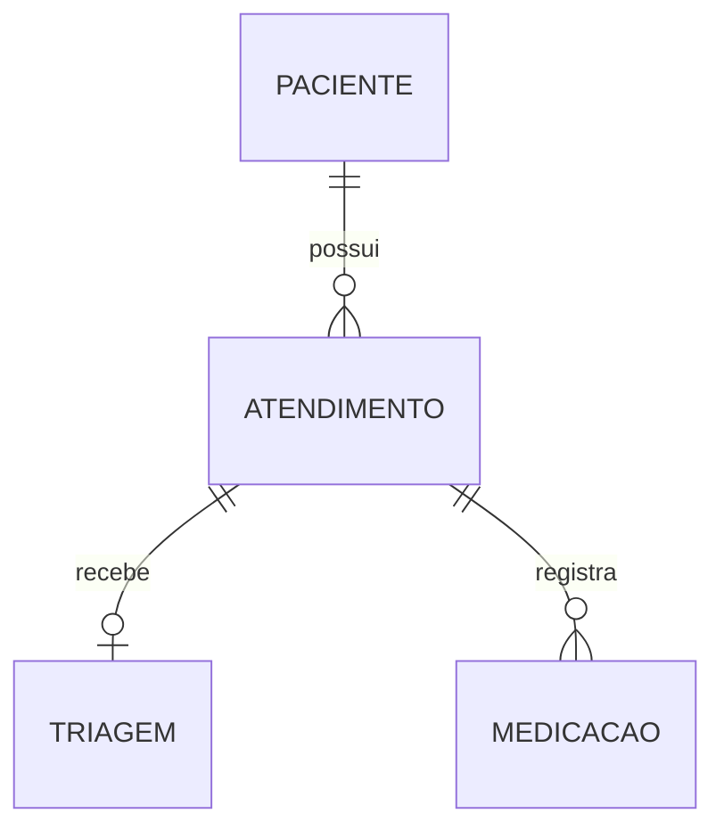

# Modelos do banco de dados

## Modelo conceitual

Um paciente pode ter vários atendimentos. Cada atendimento pertence a um paciente, pode receber uma triagem e pode registrar várias medicações. As orientações pertencem ao atendimento. A confirmação registra a alta. O cancelamento registra a data, a hora e o motivo.

## Modelo lógico

| Relação | Chave primária | Chaves candidatas e estrangeiras | Demais atributos |
| --- | --- | --- | --- |
| paciente | id_paciente | cpf (única) | nome_completo, rg, data_nascimento, nome_pai, nome_mae, endereco, telefone, data_cadastro |
| atendimento | id_atendimento | numero_atendimento (única), id_paciente → paciente | data_hora_chegada, status, data_hora_confirmacao, observacoes, orientacoes, data_hora_cancelamento, motivo_cancelamento |
| triagem | id_triagem | id_atendimento → atendimento (única) | pressao_arterial, temperatura, batimentos_cardiacos, classificacao_manchester, principais_queixas, data_hora_triagem |
| medicacao | id_medicacao | id_atendimento → atendimento | nome, posologia |

As três chaves estrangeiras são obrigatórias. A unicidade de `triagem.id_atendimento` limita a uma triagem por atendimento. A medicação tem chave própria, o que permite vários registros de medicação no mesmo atendimento.

## Modelo físico

O [DDL executável em create.sql](../sistema-pronto-socorro/create.sql) define tipos, nulabilidade, valores padrão, índices e restrições. Ele usa InnoDB e um banco com codificação `utf8mb4`. As chaves estrangeiras restringem exclusões de registros referenciados e propagam alterações das chaves.

| Tabela | Tipos e restrições físicas |
| --- | --- |
| paciente | `INT AUTO_INCREMENT` na PK, `VARCHAR(150)` para nome, `CHAR(11)` único para CPF, `DATE` para nascimento e `DATETIME DEFAULT CURRENT_TIMESTAMP` para cadastro. |
| atendimento | `INT AUTO_INCREMENT` na PK, `VARCHAR(20)` único para número, `ENUM('ABERTO','CONFIRMADO','CANCELADO') DEFAULT 'ABERTO'`, `DATETIME` para chegada, confirmação e cancelamento, `TEXT` para observações, orientações e motivo. Índices para paciente e status. |
| triagem | `INT AUTO_INCREMENT` na PK, FK única, `VARCHAR(15)` para pressão, `DECIMAL(4,1)` para temperatura, `SMALLINT` para batimentos, `TEXT` para queixas e `DATETIME DEFAULT CURRENT_TIMESTAMP` para o horário. A classificação tem índice e usa `VARCHAR(8)` com `ascii_bin` e `CHECK` para as cinco cores. |
| medicacao | `INT AUTO_INCREMENT` na PK, FK indexada, `VARCHAR(150) NOT NULL` para nome e `VARCHAR(255)` opcional para posologia. |

Na API, a confirmação grava `data_hora_confirmacao` e a consulta devolve esse valor como `dataHoraAlta`. O cancelamento grava o motivo, o status e a data e hora na mesma atualização. Registros antigos podem ter dados de encerramento nulos quando esses dados nunca foram registrados. A fila médica considera atendimentos abertos e triados, ordenados pela prioridade da cor, pela data e hora da triagem e, em caso de empate, pelo identificador da triagem.

Para uma instalação existente que já tem a tabela de triagem, aplique [002_encerramento_medicacao.sql](../sistema-pronto-socorro/migrations/002_encerramento_medicacao.sql). A instalação nova usa somente `create.sql`, que também inclui dados fictícios de exemplo.
